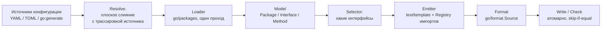
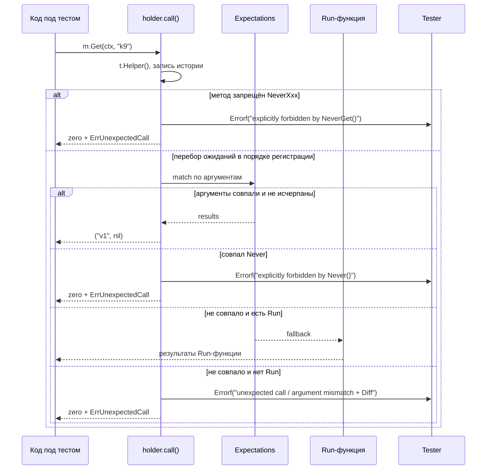

# Архитектура: конвейер генерации и рантайм

Страница объясняет, **почему** neomock устроен так, а не иначе.

## Конвейер генерации

Принципы конвейера:

- **Один загрузчик** на `go/packages` для всех видов пакетов: свой модуль,
  stdlib, внешние зависимости, `vendor/`, `go.work`. Семантика из `go/types`
  — алиасы, встраивание, generics разрешаются корректно.
- **Один шаблон** (`internal/emitter/mock.tmpl`). Кастомные шаблоны — не в v1;
  простота важнее полноты.
- **Registry импортов** назначает алиасы с дедупликацией (`template`,
  `template0`, ...) и рекурсивно обходит типы, включая `TypeArgs` инстанциаций,
  чтобы `map[K][]V` с типами из третьего пакета дал компилируемый мок.
- **Детерминизм.** Методы в генерате отсортированы по имени, импорты — по пути;
  `go/format.Source` вместо `goimports` (нечего резолвить с диска). Повторный
  прогон даёт байт-в-байт тот же файл, поэтому запись пропускается при
  совпадении байтов — mtime не трогается, Go не пересобирает пакеты.

## Путь вызова метода мока

Инварианты реализации (проверяются ревью шаблона и `-race` тестами):

1. Мок **никогда не держит мьютекс** при вызове `Tester` или Run-функции:
   сначала снимается копия состояния под локом, лок отпускается, затем вызов.
   Иначе реентранный вызов мока из `Run` дедлокнул бы, а `Fatalf` под локом
   повесил параллельные вызовы.
2. Состояние метода — один `sync.Mutex` на холдер; счётчики, история и
   ожидания только под ним.
3. Поиск ожидания пропускает исчерпанные (`calls >= max`) — отсюда семантика
   очереди для ретраев.

## Почему так: ключевые решения

### Без `EXPECT` и `mock.Anything`

Мы выбрали типизированную настройку: имя метода не передаётся строкой, а типы
аргументов берутся из сигнатуры интерфейса — опечатка в типе становится
ошибкой компиляции. Универсальный wildcard на `any` в DSL тоже не
используется: на практике «не матчить» нужно почти исключительно для
`context.Context`. Поэтому `EXPECT` не генерируется вовсе, а вместо
универсального `Anything` — один точечный маркер `neomock.Context`, который
не ломает типизацию `When`. Сложные предикаты (regex, «хотя бы один аргумент
из пяти») не решаются языком матчеров — решаются обычным Go-кодом внутри
`Run`.

### Zero-dependency рантайм

Сгенерированный мок импортирует только stdlib и пакет `neomock` — потребителю
не добавляется ни одной зависимости, включая testify. Семантика сравнения
совместима с `require.Equal`: соответствующие ~25 строк (`bytes.Equal` для
`[]byte`, `DeepEqual` для остального) завендорены в `neomock.Equal`. Это
осознанный компромисс: свой рантайм нужно поддерживать, но поверхность
минимальна (одна функция сравнения, один diff, один Verify), а регрессии
ловят сквозные `-race` тесты на golden-моках.

### Мягкий режим по умолчанию

`testing.T.FailNow` (за ним `Fatalf`) разрешён только из горутины теста.
Если мок зовёт `Fatalf` на unexpected-вызовах, то мок, который дёргают
воркеры, роняет прогон некорректно. Поэтому neomock по умолчанию репортит
`Errorf` (горутинобезопасно) и возвращает zero values, оборачивая последний
`error`-результат в `ErrUnexpectedCall` — код под тестом видит ошибку, а не
тихий ноль. Строгий режим (`Fatalf`) — осознанный opt-in для одногортинных
тестов.

### Проверка вместо перезаписи

Для CI нужен ответ «свежие ли моки» без записи. `check` генерирует в память,
сравнивает байты, печатает unified diff и завершается кодом 1 при расхождении.
Файлового кэша нет сознательно: `go/packages`-загрузка всё равно нужна, а
межпакетная инвалидация кэша даёт ложные «свежо», когда сигнатура поменялась
в соседнем пакете того же репозитория.

## Границы v1

В рамках первой версии: рантайм и DSL (When/Then/Times/Once/Optional/Never/
NeverXxx/Run/Calls/Verify), `neomock.Context`, `neomock.Diff`, конфигурация
YAML+TOML+`go:generate`, `source: go|test|all`, приватные интерфейсы через
`inpackage`, команды `init/generate/check/explain/migrate/version`, SARIF и
orphaned-репорт в `check`. За рамками: удалённые шаблоны, `replace-type`,
пользовательские шаблоны, generic-матчеры, диапазоны `Between`, файловый кэш.

## Дальше

- [Использование](usage.md) — DSL и API рантайма со стороны потребителя.
- [Разработка](development.md) — команды и правила работы с репозиторием.
