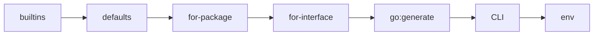

# Конфигурация

Полная справка по файлу конфигурации: обнаружение, схема, все ключи, шаблоны
имён, приоритет источников и валидация. Команды запуска — в
[CLI и генерации](cli.md), готовые рецепты — в [примерах](examples.md).

## Файл конфигурации

neomock ищет файл конфигурации по именам (первое совпадение):

```text
.neomock.yml    .neomock.yaml    .neomock.toml
```

Порядок поиска:

1. явный путь — флаг `--config PATH` или переменная `NEOMOCK_CONFIG`;
2. иначе — поиск от текущего каталога **вверх до корня файловой системы**:
   режим Б `go:generate` из подкаталога пакета находит конфиг родителя;
3. если рядом (в одном каталоге) оказались два файла из списка — ошибка:
   укажите один явно.

YAML и TOML равноправны: оба формата разбираются в одну схему и проходят одну
валидацию. `version: 1` обязателен — других версий схемы нет.

```yaml
# .neomock.yml
version: 1

defaults:
  dir: "{{.InterfaceDir}}/mocks"
  source: go

packages:
  "example.com/proj/internal/store":
    all: true
```

=== "TOML"

    ```toml
    # .neomock.toml
    version = 1

    [defaults]
    dir = "{{.InterfaceDir}}/mocks"
    source = "go"

    [packages."example.com/proj/internal/store"]
    all = true
    ```

Скелет создаёт `go tool neomock init [--format yaml|toml] [--path PATH]` —
он не перезаписывает существующий файл.

## Структура файла

```text
version: 1
defaults:            # настройки для всех пакетов (блок Settings)
packages:
  "<import path>":   # секция пакета
    all: true        # ровно один селектор: all | include | interfaces
    include: "..."   # regexp имён интерфейсов
    exclude: "..."   # regexp исключения (только вместе с include)
    interfaces:
      <Имя>:
        source-interface: <Источник>   # алиас (опционально)
        config: { ... }                # настройки интерфейса
    config: { ... }                    # настройки пакета
```

### Селекторы пакета

Секция пакета обязана задать **ровно один** селектор:

| Селектор | Смысл |
|---|---|
| `all: true` | все интерфейсы пакета (constraint-интерфейсы пропускаются с предупреждением) |
| `include: "<regexp>"` | интерфейсы, чьи имена совпадают с regexp; `exclude` уточняет (только с `include`) |
| `interfaces:` | точечный список имён с опциональными настройками каждого |

`exclude` без `include` — ошибка конфигурации. `include`/`exclude` —
**строки-регулярные выражения**, а не списки имён.

```yaml
packages:
  "example.com/proj/internal/repo":
    include: "^(User|Order)Repo$"
    exclude: "Legacy"
```

### source-interface (алиас)

`source-interface` генерирует мок из другого интерфейса того же пакета —
полезно, когда публичный контракт — алиас или инстанциация:

```yaml
packages:
  "example.com/proj/internal/db":
    interfaces:
      UserStore:
        source-interface: Store   # мок типа Store[User], имя — UserStore
```

## Ключи настроек

Один и тот же блок настроек (`Settings`) задается в `defaults`, в
`config` пакета и в `config` интерфейса. nil-поле означает «не задано на этом
слое» и заполняется из более слабого слоя.

| Ключ | Тип | Дефолт | Назначение |
|---|---|---|---|
| `dir` | шаблон | `{{.InterfaceDir}}/mocks` | каталог мока; абсолютный или относительно корня модуля |
| `filename` | шаблон | `{{.InterfaceSnake}}_mock.go` | имя файла мока |
| `pkgname` | строка | `mocks` | имя пакета мока; пусто — пакет источника |
| `structname` | шаблон | `{{.Mock}}{{.InterfaceName}}` | имя структуры мока (`MockStore`, приватный — `mockrefresher`) |
| `source` | `go` \| `test` \| `all` | `go` | откуда брать интерфейс (см. ниже) |
| `inpackage` | bool | `false` | мок в пакете источника (тестовые моки рядом с кодом) |
| `build-tags` | строка | `""` | теги сборки для загрузки источника, через запятую |
| `force-write` | bool | `true` | `false` — не затирать файл с ручной правкой (видно в `check`) |
| `verify-build` | bool | `false` | после записи выполнить `go build` пакета мока |
| `strict-calls` | bool | `false` | базовый режим ошибок вызовов мока (см. [DSL](usage.md)) |
| `history` | bool | `true` | `false` — не генерировать `XxxCalls`/`XxxCallsCount` и запись истории |
| `generate-line` | bool | `true` | `false` — не вставлять `//go:generate`-директиву в сгенерированный файл |
| `recursive` | bool | `false` | разрешает паттерн `<pkg>/...` для своего модуля |
| `exclude-packages` | список regexp | — | исключения import path при `/...` обходе |
| `template-data.boilerplate-file` | путь | `""` | файл с шапкой (лицензией) перед маркером «Code generated» |

### source: откуда берётся интерфейс

| Значение | Загружаются файлы | Типичный кейс |
|---|---|---|
| `go` | только исходники пакета | обычный публичный контракт |
| `test` | только `_test.go` пакета | интерфейс объявлен в тестах (`SourceTest`) |
| `all` | исходники + тесты | интерфейс в `_test.go`, но моки нужны и в `go`-коде |

При `source: test|all` файл мока должен оканчиваться на `_test.go` — иначе
генератор предупреждает, что мок попадёт в прод-сборку. Если хотя бы у одного
интерфейса секции стоит `source: test|all`, перечисление интерфейсов пакета
расширяется до `all` (union), а фактический `source` применяется при загрузке
каждого интерфейса.

### Placement rules: куда можно класть мок

- Каталог мока обязан быть **внутри текущего модуля** — для внешних пакетов
  (`io`, `net/http`, чужие модули) нужно явно задать `dir` внутрь проекта:

    ```yaml
    packages:
      "io":
        interfaces:
          Reader:
            config:
              dir: "./internal/testmocks"
              pkgname: testmocks
    ```

- `inpackage: true` для внешнего пакета физически невозможен — ошибка.
- `inpackage: true` требует пустой `pkgname` или имя пакета источника.
- `inpackage: false` требует непустой `pkgname`.
- Рекурсивный паттерн `example.com/proj/...` требует `recursive: true` в
  `config` пакета и работает только внутри своего модуля; внешние пакеты
  перечисляйте явно. Исключения — `exclude-packages` (regexp по import path).

### Директива исключения

Интерфейс в исходнике можно пометить директивой — он исключается из любой
селекции (`all`/`include` — молча, явный список — с предупреждением):

```go
//neomock:generate=false
type InternalOnly interface { ... }
```

## Шаблоны имён

`dir`, `filename`, `structname` — Go-шаблоны, рендерятся **один проход**
(вложенность шаблонов не поддерживается). Переменные:

| Переменная | Пример значения |
|---|---|
| `{{.InterfaceName}}` | `ResponseWriter` |
| `{{.InterfaceSnake}}` | `response_writer` |
| `{{.Mock}}` | `Mock` (экспорт) / `mock` (приватный интерфейс) |
| `{{.StructName}}` | уже отрендеренное имя структуры (доступно в `dir`/`filename`) |
| `{{.SrcPackageName}}` | `http` |
| `{{.SrcPackagePath}}` | `net/http` |
| `{{.InterfaceDir}}` | абсолютный каталог исходников интерфейса |
| `{{.InterfaceDirRelative}}` | каталог интерфейса относительно корня модуля |
| `{{.InterfaceFile}}` | `transport.go` |

Функции шаблонов: `lower`, `upper`, `title`, `snake`, `base`, `dir`,
`replaceAll` (аргументы: `старое новое строка`).

Примеры:

```yaml
structname: "{{.Mock}}{{.InterfaceName}}"          # MockStore / mockrefresher
filename: "{{.InterfaceSnake}}_mock.go"           # store_mock.go
dir: "{{.InterfaceDirRelative}}/testmocks"        # рядом с пакетом, но отдельным пакетом
filename: "mock_{{ lower .SrcPackageName }}_{{.InterfaceSnake}}.go"
```

`snake` разбивает CamelCase по границам слов и акронимов:
`ResponseWriter → response_writer`, `HTTPServer → http_server`, `IDKey → id_key`.

## Приоритет источников

Значения применяются от слабого к сильному; каждое поле запоминает слой,
котороё задало (видно в `explain`):



Файл и `go:generate`-строка равноправны, но строка сильнее файла: она
инициировала запуск. В режиме А `--out` перекрывает `dir`/`filename` конфига.

Диагностика конкретного интерфейса:

```console
$ go tool neomock explain example.com/proj/internal/store.Store
interface: example.com/proj/internal/store.Store
  dir:           ./internal/store/mocks   (for-package ...)
  filename:      store_mock.go            (builtins)
  pkgname:       mocks                    (builtins)
  structname:    MockStore                (builtins)
  source:        go                       (builtins)
  inpackage:     false                    (builtins)
  strict-calls:  false                    (builtins)
  history:       true                     (builtins)
  generate-line: true                     (builtins)
```

## Валидация

Схема закрытая: неизвестный ключ — ошибка с подсказкой похожих
(редакционное расстояние ≤ 2):

```text
config: defaults: неизвестный ключ "srict-calls", возможно, вы имели в виду: strict-calls
```

Ключи наследия mockery (`unroll-variadic`, `with-expecter`, `template`,
`packages-templates`) удалены в ред. 2 — вместо них ошибка с объяснением и
указанием на миграцию. Прочие проверки: `version` обязан быть 1; ровно один
селектор пакета; `exclude` только с `include`; `source` ∈ `go|test|all`;
булевы/строковые типы значений.

## Переменные окружения

| Переменная | Действие |
|---|---|
| `NEOMOCK_CONFIG` | явный путь к файлу конфигурации (слабее `--config`) |
| `NEOMOCK_LOG_LEVEL` | `debug` \| `info` \| `warn` \| `error` (слабее `--log-level`) |

## Дальше

- [CLI и генерация](cli.md) — команды, флаги, go:generate, коды возврата.
- [Примеры](examples.md) — все типовые случаи с готовым кодом.
- [Использование](usage.md) — DSL мока в тестах.
